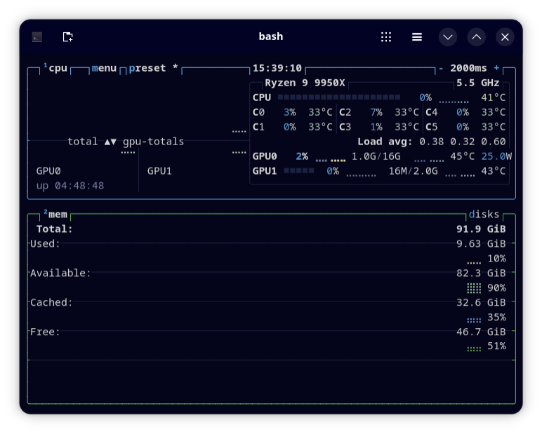

# Deepwick for btop

A deep navy theme for [btop](https://github.com/aristocratos/btop).

> Deepwick is an unofficial theme derived from
> [Polywick Blue](https://vscode.polywickstudio.net) by Polywick Studio (MIT).
> Not affiliated with Polywick Studio.



## Install

```sh
mkdir -p "${XDG_CONFIG_HOME:-$HOME/.config}/btop/themes"
cp deepwick.theme "${XDG_CONFIG_HOME:-$HOME/.config}/btop/themes/"
```

Choose **deepwick** under **Options → Color theme** (press `o`), or set in
`btop.conf`:

```ini
color_theme = "deepwick"
truecolor = True
```

## Notes

- btop gradients have three stops, so load gradients (CPU, temperature,
  processes) run Blue → Yellow → Red.
- Box outlines: CPU Blue, memory Green, network Magenta, processes Teal.

Tested with btop 1.4.7.

## License

MIT. See [LICENSE](LICENSE).
